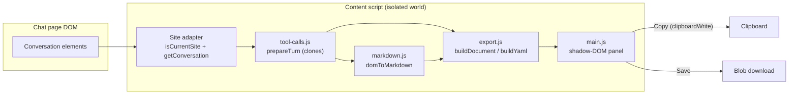

# Project Architecture

## Overview

chat-to-markdown is a Manifest V3 Chrome **content-script-only** extension
that exports the LLM conversation currently visible in the page to Markdown
or API-format YAML. There is no build step, no bundled dependencies, no
background worker, no storage, and no network access: every module is a plain
IIFE attaching to the shared `window.ChatToMarkdown` (`C2M`) namespace, loaded
in a fixed order by `chrome/manifest.json`. Parsing runs entirely locally in
the page's content-script isolated world; output reaches only the preview
panel, the clipboard, or a browser download.

→ *Directory map: [PROJ-LAYOUT.md](PROJ-LAYOUT.md)*

## System Diagram

## Core Components

| Component | Purpose |
|-----------|---------|
| Adapter layer (`chrome/src/content/adapters/`) | Reads the current site's DOM: `isCurrentSite()` gate plus `getConversation()` → `{title, turns: [{role, element}]}`. Adapters speak in DOM elements; nothing downstream sees site specifics. |
| `generic.js` engine | Drives experimental sites from candidate `[userSel, asstSel]` selector pairs; turns are ordered by `compareDocumentPosition`. No pair matches ⇒ adapter reports null and the page stays button-less (graceful no-op). |
| `tool-calls.js` | Shared summarizer: collapses `
`/`class*="tool-call"` chips into `tool-call made to …` summary lines (MD mode) or `role: tool` messages (YAML mode). Works on clones — never mutates the page. |
| `markdown.js` converter | Site-agnostic DOM → Markdown: headings, paragraphs w/ leading-construct escaping, nested lists, fenced code with language tags, tables, blockquotes, KaTeX `$…$` via `<annotation encoding="x-tex">`, links/bold/italic/code spans, hidden-node (aria-hidden/sr-only) filtering. |
| `export.js` | Document assembly for both modes, YAML escaping, filename slugging (`slug-title-YYYY-MM-DD.md`), clipboard copy with `execCommand('copy')` fallback, blob download. |
| `main.js` UI | Shadow-DOM floating button + preview panel: MD/YAML tabs, ⇅ message-order toggle, Refresh/Copy/Save, toasts. |

## Adapter Contract

Each adapter registers onto `C2M.adapters` with:

- `isCurrentSite() -> bool` — hostname suffix match, or pure DOM-signature
  detection (Open WebUI family: `[id^="message-"]` + `.chat-user`/`.chat-assistant`,
  so any self-hosted instance matches without configuration).
- `getConversation() -> {title, turns} | null` — null when no conversation is
  mounted; the UI then shows "No conversation found".
- optional `prepareTurn(el) -> {element, elementClean, tools}` — the shared
  tool-call summarizer; MD mode renders `element` (chips replaced by summary
  lines), YAML mode renders `elementClean` (chips stripped) plus the
  `tools[]` records.

`adapters/index.js` picks the first adapter whose `isCurrentSite()` is true.
Adding a platform = one new adapter file + two manifest edits (`js` list,
`matches` — the match set is already broad `http(s)://*/*`, so usually just
the `js` list).

## Data Flow

Button click → `captureDoc()` snapshots the conversation (turn clones, meta,
filename base) → `rebuild()` renders both documents for the current
mode/order → preview `textarea` shows the active one → Copy writes the
preview value to the clipboard, Save downloads it under the slugged filename.
Refresh re-snapshots in place, preserving the user's scroll anchor.

## Key Decisions

- **No build step, zero dependencies** — every file ships as authored; the
  release zip is a plain `zip` of `chrome/`.
- **Shadow DOM isolation, both ways** — site CSS can't touch the panel and
  the panel can't leak styles into the page.
- **Host attached to `document.documentElement`** — SPA re-renders inside
  `<body>` can't remove the button.
- **Polling `start()` every 1.5 s** — DOM-signature adapters can only match
  after the SPA mounts a conversation, so injection retries until it wins.
- **Converter touches a minimal DOM surface** (`nodeType`, `tagName`,
  `childNodes`, `children`, `textContent`, `getAttribute`) so the same module
  runs unmodified under the zero-dep `test/mini-dom.js` in Node.
- **Broad content-script matches** (`https://*/*`, `http://*/*`) so
  DOM-signature sites (Open WebUI family) work at any host; the script is
  inert wherever no adapter matches.

## Technology Stack

Vanilla ES5-style JavaScript (IIFEs, no modules) · Chrome Manifest V3
(minimum Chrome 110) · `node:test` + custom mini-DOM for tests ·
GitHub Actions for release packaging (push-to-`release` ⇒ versioned zip +
GitHub Release).

## Data Contracts

Output document shapes — Markdown front-matter/turn structure and the YAML
`messages:` payload — are documented in [PROJ-SCHEMA.md](PROJ-SCHEMA.md).

## Security Posture

No network egress, no storage, single `clipboardWrite` permission; boundary
analysis and vulnerability register in [THREAT-MODEL.md](THREAT-MODEL.md).
