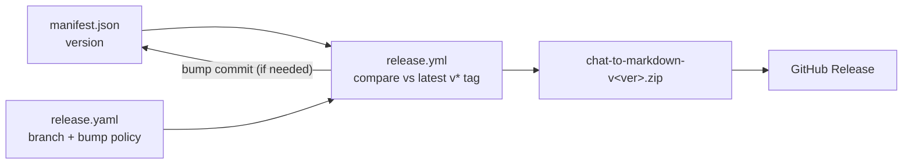

# Project Schema — Data Reference

## Persistence Layer

**There is none.** The extension uses no database, no `chrome.storage`, no
localStorage/IndexedDB, no KV store, and no migrations. Runtime state is a
handful of in-memory module variables (panel mode, order flag, the captured
turns); the only bytes that ever leave the process are the user-initiated
clipboard copy and download. Per the schema-doc scope rules, the ERD sections
are skipped for non-relational repos; this document covers the structured
data that does exist: config files, the export data interfaces (the project's
actual data products), and the test fixture harness.

## Config Schemas

### `chrome/manifest.json` (Manifest V3)

| Key | Type | Notes |
|-----|------|-------|
| `manifest_version` | 3 | fixed |
| `name` / `description` | string | store-listing copy |
| `version` | string (`"0.6.1"`) | **release source of truth**; patch auto-bumped by CI when ≤ latest tag |
| `minimum_chrome_version` | `"110"` | floor for the APIs used |
| `permissions` | `["clipboardWrite"]` | the only permission — no storage, no tabs, no host permissions beyond content scripts |
| `icons` / `action.default_icon` | path map | 16 / 48 / 128 px |
| `content_scripts[0].matches` | `["https://*/*", "http://*/*"]` | deliberately broad — DOM-signature sites (Open WebUI family) can't be enumerated by host |
| `content_scripts[0].js` | string[14] | load order: `markdown.js`, `export.js` → `tool-calls.js`, `generic.js` → per-site adapters → `index.js` → `main.js` |
| `content_scripts[0].run_at` | `"document_idle"` | injection point |

### `release.yaml` (pipeline config)

| Key | Type | Notes |
|-----|------|-------|
| `version.file` | path | `chrome/manifest.json` |
| `version.tag_prefix` | string | `v` |
| `release.branch` | string | `release` — pipeline trigger |
| `release.auto_bump` | enum | `patch` when manifest version ≤ latest tag |
| `artifact.name` | template | `chat-to-markdown-v{{version}}.zip` |
| `artifact.root` | path | `chrome` — manifest at archive root |
| `release_notes.body_file` | path | `.github/RELEASE_BODY.md` |

Layering: `manifest.json` version → `release.yaml` policy → `.github/workflows/release.yml`
mechanics (read version → compare tags → optional bump commit → zip → release).



## Export Data Interfaces (primary data products)

### Markdown mode — `export.js` `buildDocument(meta, turns)`

```text
---
title: "<yaml-escaped>"
source: <hostname>
url: <page url>
exported: YYYY-MM-DD
---

# <title>

## User
<body>

* * *

## Assistant
<body>
```

| Field | Source | Notes |
|-------|--------|-------|
| `title` | adapter / `document.title` | omitted when empty |
| `source` | `location.hostname` | |
| `url` | `location.href` | |
| `exported` | capture-time ISO date | `YYYY-MM-DD` |
| turns | `role` ∈ `user \| assistant` | bodies separated by `* * *`; tool chips appear as `tool-call made to …` / `tool-call-response: …` lines |

### YAML mode — `export.js` `buildYaml(meta, turns)`

Top-level keys `title`, `source`, `url`, `exported` (same semantics), then a
`messages:` list in chat-API shape:

| Entry | Fields | Notes |
|-------|--------|-------|
| conversation turn | `role: user\|assistant`, `content: |-` block scalar | content indented 6 spaces; empty bodies → `content: ""` |
| tool invocation | `role: tool`, `name: "<chip name>"`, `content: "<escaped summary>"` | summary = `tool-call-response: <status> response <size>`; the chip payload itself is stripped |

### Filename scheme — `export.js` `buildFilename(title)`

`<slug>-YYYY-MM-DD.md` (or `.yaml` in YAML mode). Slug: lowercase,
`[^a-z0-9]+ → '-'`, trailing dashes trimmed, 60-char cap; fallback `chat`.

### Tool-call summary record — `tool-calls.js` `summarize(el)`

| Field | Type | Source |
|-------|------|--------|
| `name` | string, ≤120 chars, whitespace-collapsed | `<summary>` text, else `aria-label`, else `"tool call"` |
| `status` | `"ok"` or 3-digit code | HTTP code only when the chip text shows one (`\b[1-5]\d{2}\b`) |
| `bytes` | number | chip `textContent.length` |

## Test Fixtures

- `test/mini-dom.js` — synthetic DOM implementing exactly the surface the
  converter touches (`nodeType`, `tagName`, `childNodes`, `children`,
  `textContent`, `getAttribute`) plus `h(tag, attrs, …kids)` / `text(str)`
  builders; `markdown.js` runs against it unmodified.
- Fixture conversations are built inline in `test/markdown.test.js` and
  `test/export.test.js`; there are no fixture files or data directories.

## Migration History

None — there is no schema-bearing store to migrate.
