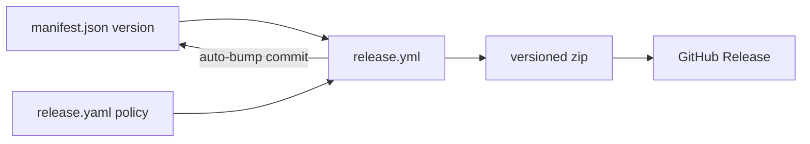

# Project Schema — Summary

- **No persistence layer.** No DB, no `chrome.storage`, no localStorage/KV, no
  migrations, no ERDs. Structured data = config files + export interfaces +
  test fixtures.
- **Config:** `chrome/manifest.json` (MV3; `version` = release source of
  truth; sole permission `clipboardWrite`; broad `http(s)://*/*` content-script
  matches; 14-file load order) and `release.yaml` (`release` branch,
  `auto_bump: patch`, artifact `chat-to-markdown-v{{version}}.zip`).

- **Markdown export:** YAML front-matter (`title`/`source`/`url`/`exported`)
  + `# title` + `## User`/`## Assistant` turns separated by `* * *`; tool
  chips as `tool-call made to …` lines.
- **YAML export:** same header keys + `messages:` list —
  `role: user|assistant` with `content: |-` block scalars, `role: tool`
  entries (`name`, `content` = `tool-call-response: <status> response <size>`).
- **Filenames:** `<slug>-YYYY-MM-DD.md|.yaml` (lowercase slug, 60-char cap,
  fallback `chat`).
- **Tool-call record:** `name` (≤120 chars) / `status` (`ok` or shown HTTP
  code) / `bytes` (chip text length).
- **Fixtures:** `test/mini-dom.js` synthetic DOM + inline fixtures; no
  fixture files.

Details: `docs/PROJ-SCHEMA.md`.
