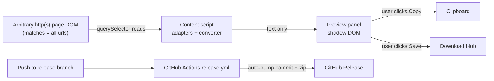

# Threat Model

## Overview

chat-to-markdown is a local, content-script-only Chrome extension. The assets
that matter: (1) the user's conversation content, (2) the integrity of what
lands on the clipboard or in the downloaded file, (3) the inertness of the
extension on pages it does not recognize. There is no server, no account, no
storage, and — verified against source on 2026-10-27 — no network API usage
of any kind (`fetch`, `XMLHttpRequest`, `WebSocket`, and every `chrome.*` call
are absent from `chrome/src/`; the manifest's only permission is
`clipboardWrite`). Exfiltration therefore has no built-in channel: the only
copy of the exported document the extension ever produces is handed to the
user on the page it came from.

Trust boundaries:

1. **Web page DOM (untrusted, arbitrary site) ↔ content script** — the
   content script is injected into every http(s) page but only *acts* on
   adapter match.
2. **Content script ↔ user-initiated sinks** — preview panel, clipboard,
   download. All egress is click-driven.
3. **CI/release pipeline ↔ repository** — the release workflow holds
   `contents: write` and pushes auto-bump commits.

## Attack Surface

Enumeration: every ingress is a DOM read on the current page (adapters);
every egress is one of Copy / Save / the CI release publish. There are no
webhooks, queues, sockets, background pages, or message listeners.

## Vulnerability Register

| ID | Severity | STRIDE | Component | Status |
|----|----------|--------|-----------|--------|
| T-001 | Low | Information disclosure | Broad `http(s)://*/*` content-script match runs detection logic on every page visited | Mitigated — without an adapter match the script is inert (no UI, no reads, no writes); PRIVACY.md documents this |
| T-002 | Low | Spoofing | A page can craft the Open WebUI DOM signature (`[id^="message-"]` + `.chat-user`/`.chat-assistant`) to summon the export button on a non-chat page | Accepted — output goes only to the user's own clipboard/download on that same page; worst case is a confusing button |
| T-003 | Low | Tampering | Page-controlled text flows into the exported document | Mitigated — Markdown mode escapes leading constructs (`#`, `>`, `1.`); YAML mode double-quote-escapes (`yamlEscape`); filenames fully slugified; the panel renders via `value`/`textContent` only — page-derived HTML is never re-inserted as markup |
| T-004 | Low | Elevation of privilege | Content script compromise surface | Mitigated by platform (isolated world); the extension registers no message listeners, declares no `externally_connectable`, and calls no `chrome.*` APIs |
| T-005 | Low | Denial of service | `main.js` polls `start()` every 1.5 s indefinitely on pages that never match an adapter | Accepted — one selector sweep per 1.5 s, cleared on first match; negligible cost |
| T-006 | Low | Supply chain | Release workflow pins `actions/checkout@v4` by tag (not SHA) and runs with `contents: write`, able to push auto-bump commits to `release` | Open — single-job workflow, low blast radius; pin by SHA if hardening |
| T-007 | Info | Repudiation | No server, no logs, no audit surface | Not applicable |

## Mitigation Coverage

3 mitigated · 0 partial · 1 open (T-006) · 2 accepted (T-002, T-005) ·
1 not applicable. No tracking tickets exist for this repo — this register is
the tracker; re-review on any new adapter, permission, or manifest change.

## Residual Risk

- **Fail-closed by design:** a drifted selector makes the button disappear;
  it cannot make the extension read or send anything new.
- The download filename derives from a page-controlled title but is fully
  slugified (`[^a-z0-9]+ → '-'`, 60-char cap) — no path traversal.
- EXPERIMENTAL adapters (`grok.js`, `groq.js`) ship candidate selector pairs
  that match no live site today; their exposure is exactly T-001/T-002, no
  more.
- Export fidelity, not security, is the realistic failure mode: mis-detected
  turns produce a wrong local file, which the user previews before acting on.

## Verification Notes

- "No network egress / no storage" verified by
  `grep -rn "fetch(\|XMLHttpRequest\|WebSocket\|chrome\." chrome/src/` → no
  matches (2026-10-27).
- `node --test` suite: 22 tests, all green at documentation time.

→ *Component map: [PROJ-LAYOUT.md](PROJ-LAYOUT.md) · data shapes: [PROJ-SCHEMA.md](PROJ-SCHEMA.md)*
